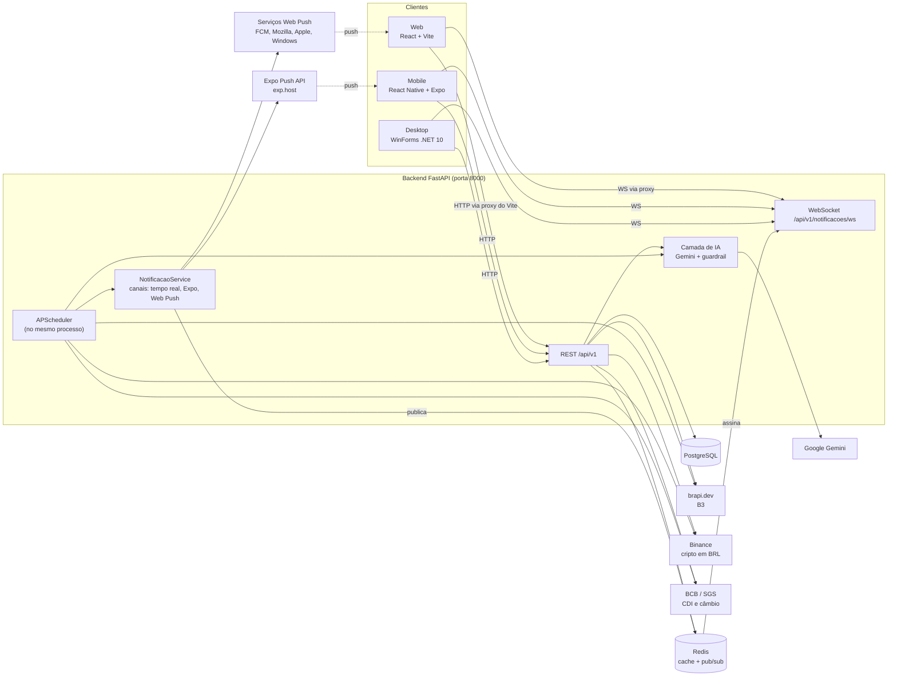
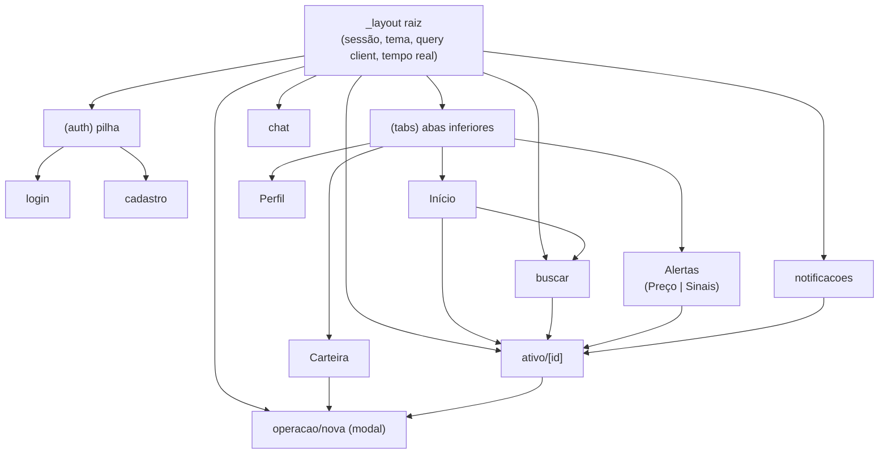
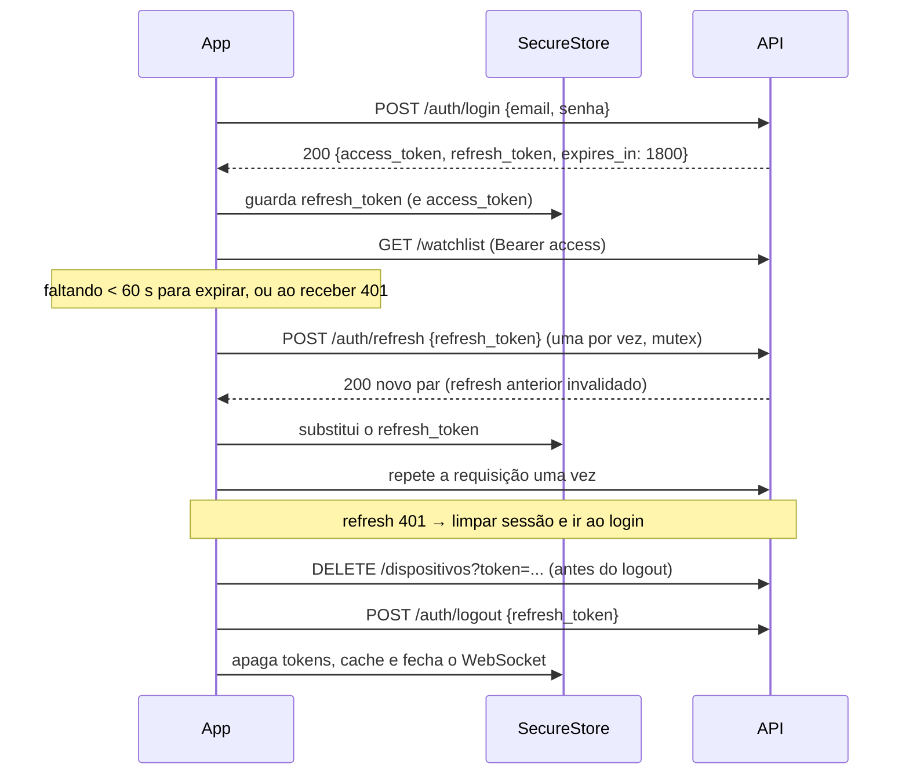
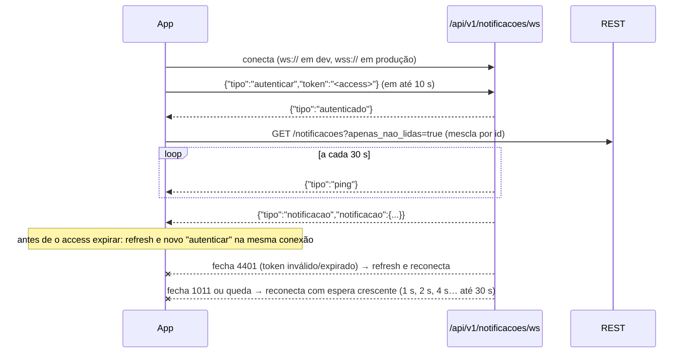

# Mapeamento da organização InsightF-AI para o app mobile

Fase 1 (somente leitura) do desenvolvimento do app mobile do InsightFlow. Nenhum código do backend, web ou desktop foi alterado. Onde o contexto recebido divergiu do código, **o código venceu** e a divergência está registrada.

| Fonte | Versão lida |
| --- | --- |
| `Insight-flow-backend` | `develop` em `ef8dfe2` (09/10/2026). `main` (`a8bcb02`) tem o mesmo conteúdo |
| `Insight-flow-web` | `main` em `b294efb` (09/10/2026) |
| `Insight-flow-desktop` | `main` em `804a300` (10/10/2026) |
| `Insight-flow-mobile` | remoto vazio; cópia local com 4 branches (ver §1.4) |
| `.github` | `profile/README.md` |
| `docs/api-reference.html` do backend | "atualizado 07/10/2026", branch `develop` |
| Documentos do projeto (Downloads) | `Doc.pdf` (escopo e stack v1.0, ago/2026), `documentacao-tecnica.docx` (v1.0, ago/2026), `Checkpoint01-Mobile.pdf`, `Checkpoint02-Mobile.pdf` |

Data do mapeamento: 10/10/2026.

## Resumo dos achados que mudam o plano

1. **O mobile não está vazio.** O GitHub está vazio, mas `C:\Users\Bruno\Insight-flow-mobile` tem um MVP (Expo SDK 57, Expo Router, TanStack Query, Zustand, SecureStore, Victory Native) e um redesign com a identidade do web, nunca enviados. Esse MVP foi feito contra o backend de 25/09 e não tem refresh token, WebSocket, push, IA nem candles, que o backend já oferece hoje.
2. **O web não está mais só mockado.** Desde `42f9176` (09/10) ele consome a API real em autenticação, watchlist, ativos, sinais, alertas, portfólio, IA, notificações por WebSocket e web push. Continuam mockados: notícias, rankings, maiores altas/baixas, faixa de cotações, score, comparador, perfil, troca de senha, sessões e recuperação de senha. Em vários pontos o web **cai no mock em silêncio** quando a API falha ou o ativo não está na watchlist.
3. **A IA do backend só tem o provedor Gemini** (`gemini-3.5-flash`). Claude, OpenAI e Ollama aparecem nos documentos e como variáveis no `.env.example`, mas não há implementação. A IA vem desligada por padrão (`AI_HABILITADA=false`) e as rotas respondem 503.
4. **O push mobile é via Expo Push** (não FCM/APNs direto): o app manda um `ExponentPushToken[...]` para `POST /dispositivos`. O backend já envia sinal, alerta e resumo diário por push e confere os recibos.
5. **A busca não devolve `id`.** O `ativo_id` exigido pelas rotas de ativo só aparece depois de adicionar à watchlist ou criar um alerta. Não há `GET /usuarios/me`: o nome do usuário só é conhecido no cadastro.
6. **Unidades diferentes:** cotação e backtest vêm em pontos percentuais (`"1.51"` = 1,51%); rentabilidade, benchmark e distribuição vêm em **fração** (`"0.0245"` = 2,45%). Todo decimal chega como **string**.
7. **Prazo da disciplina:** o Checkpoint 02 de Programação Mobile vence em **20/10/2026** e pede navegação, consumo GET da API, `async/await`, `useEffect`, estado, separação UI/API e os estados "com dados", "vazio", "carregando", "falha de comunicação" e "erro do servidor". A issue #9 do backend (atribuída a `brunoosouza09`) tem checklist próprio e um pedido de status do Vinicius.

---

## 1. Arquitetura da organização

### 1.1 Repositórios

| Repositório | Stack real | Visibilidade | Estado |
| --- | --- | --- | --- |
| `Insight-flow-backend` | Python 3.12 (Docker), FastAPI, SQLAlchemy 2.0 + psycopg2, PostgreSQL 16, Redis 7, APScheduler, pandas-ta, httpx | público | Ativo. 154 arquivos de teste. Doc de API em HTML. CI/CD no GitHub Actions |
| `Insight-flow-web` | React 18, Vite 5, TanStack Query 5, Zustand 5, React Router 6, Tailwind 3, Lightweight Charts 4, Recharts 2, lucide-react | privado | Híbrido real + mock (ver §7). README ainda diz "dados mockados" |
| `Insight-flow-desktop` | C#, .NET 10, Windows Forms, gráfico desenhado à mão, `NotifyIcon` | privado | Integrado ao backend real, com os melhores registros de integração (`docs/`) |
| `Insight-flow-mobile` | — | privado | Remoto vazio (sem branch padrão). Conteúdo só local (§1.4) |
| `.github` | — | privado | Só `profile/README.md` (apresentação da organização) |

### 1.2 Quem chama quem



Nenhum cliente fala com Postgres, Redis, brapi, Binance, BCB ou Gemini. Todas as chaves ficam no servidor.

### 1.3 Backend por dentro

| Camada | Pasta | Papel |
| --- | --- | --- |
| Controllers | `src/app/api/v1/controllers` | 10 routers: `usuarios`, `auth`, `watchlist`, `ativos`, `alertas`, `notificacoes`, `dispositivos`, `web_push`, `portfolio`, `analise_ia` |
| Schemas | `src/app/api/v1/schemas` | Pydantic v2 (contratos de request/response) |
| Dependências | `src/app/api/deps.py` | Injeção de repositórios, serviços, clientes HTTP e `get_usuario_atual` (Bearer) |
| Middleware | `src/app/api/correlacao.py` | `X-Request-ID` em toda resposta HTTP, log estruturado por requisição |
| Core | `src/app/core` | `config.py` (pydantic-settings), `security.py` (JWT HS256), `logs.py` |
| Domínio | `src/app/domain` | Entidades, enums, value objects, regras de sinal fixas |
| Serviços | `src/app/services` | Regras de negócio (watchlist, alertas, indicadores, sinais, portfólio, IA, chat, notificações, push, refresh token) |
| Repositórios | `src/app/repositories` | Interfaces + SQLAlchemy |
| Integrações | `src/app/integrations` | brapi, Binance, BCB, Expo, Web Push (VAPID + RFC 8291), limitador de taxa e retentativa |
| IA | `src/app/ai` | Provedor Gemini, prompts versionados, ferramentas do chat (function calling), guardrail de linguagem e aviso legal |
| Notificações | `src/app/notifications` | Canais (tempo real via Redis, Expo, Web Push), payload do push, WebSocket |
| Scheduler | `src/app/scheduler` | Jobs periódicos |

Jobs do scheduler (`scheduler/jobs.py`):

| Job | Quando | O que faz |
| --- | --- | --- |
| `ciclo_renda_variavel` | a cada 15 min | Cotação dos ativos (ACAO/FII/ETF/BDR) em watchlist ou com alerta ativo. Avalia alertas de preço; para ativos em watchlist, atualiza histórico, avalia sinais e notifica sinais **novos** a quem tem `notificar: true` |
| `ciclo_cripto` | a cada 5 min | O mesmo para CRIPTO |
| `indices_referencia` | 19h00 (America/Sao_Paulo) | Atualiza o histórico do Ibovespa (`^BVSP`, tipo `INDICE`) |
| `recibos_push` | a cada 30 min (se push Expo ligado) | Confere recibos da Expo e desativa tokens `DeviceNotRegistered` |
| `resumo_diario` | 18h30 (America/Sao_Paulo), só com IA ligada | Gera o resumo da carteira de cada usuário com operações e envia como notificação `RESUMO_DIARIO`. Para no primeiro erro de cota |

Variáveis de ambiente relevantes ao mobile (só nomes; ver `.env.example`): `CORS_ORIGENS` (não afeta app nativo), `JWT_SECRET_KEY`, `JWT_EXPIRATION_MINUTES` (30), `REFRESH_TOKEN_EXPIRACAO_DIAS` (30), `WS_TIMEOUT_AUTENTICACAO_SEGUNDOS` (10), `WS_INTERVALO_PING_SEGUNDOS` (30), `EXPO_PUSH_HABILITADO`, `EXPO_ACCESS_TOKEN` (opcional), `AI_HABILITADA`, `AI_PROVIDER`, `GEMINI_API_KEY`, `GEMINI_MODEL`, `CHAT_MAX_MENSAGENS` (20), `CHAT_MAX_CARACTERES_MENSAGEM` (2000), `BRAPI_API_KEY`, `SCHEDULER_INTERVALO_*`.

`docker compose up` sobe Postgres, Redis e a API em `http://localhost:8000` com migrations automáticas e Swagger em `/docs`. O compose carrega `.env` se existir (opcional). O problema antigo de `No module named 'psycopg'` foi corrigido (`sqlalchemy<2.1` + `psycopg2-binary`).

### 1.4 Estado do `Insight-flow-mobile` e do `.github`

**No GitHub:** repositório privado `InsightF-AI/Insight-flow-mobile`, vazio (sem branch padrão, sem issues). Só a conta `brunoosouza09` tem acesso de escrita; a conta ativa do `gh` nesta máquina (`atendimentoraiox`) não enxerga o repositório.

**Na máquina** (`C:\Users\Bruno\Insight-flow-mobile`, árvore limpa, HEAD em `feature/redesign-web`):

| Branch local | Commits | Último | Conteúdo |
| --- | --- | --- | --- |
| `main` | 2 | `df0892a` 25/09 | README e spec do MVP |
| `develop` | 2 | `df0892a` 25/09 | igual a `main` |
| `feature/app-mobile-mvp` | 31 | `d6883fe` 26/09 | MVP de 16 tarefas |
| `feature/redesign-web` | 56 | `86a6e49` 26/09 | MVP + identidade visual do web |

O que o MVP local já tem: Expo SDK 57 (React Native 0.86, React 19.2, TypeScript 6), Expo Router com grupos `(auth)` e `(tabs)`, TanStack Query, Zustand, `expo-secure-store`, Victory Native 42 (Skia), lucide, Inter + Space Grotesk, tema escuro padrão e claro alternável (com ajustes de contraste AA), ESLint, `tsc`, Jest + RNTL e CI no GitHub Actions. Telas: login, cadastro, Início (watchlist), Portfólio, Alertas, Perfil, detalhe do ativo, busca, nova operação e chat (placeholder). Segundo o registro da sessão anterior, 42 suítes e 372 testes passavam; não foram executados de novo nesta fase.

O que falta frente ao backend atual: refresh token e logout remoto (o client derruba a sessão no primeiro 401), WebSocket (hoje usa polling de 60 s), push via `/dispositivos`, análise por IA e chat reais (hoje mostram "disponível em breve"), gráfico de candles, timeouts maiores para IA e o tratamento de `desatualizada`/cota. Há sobras do template Expo para remover (`AGENTS.md`, `LICENSE`, `.claude/settings.json`, `assets/favicon.png`), e o ícone adaptativo do Android ainda usa o fundo `#E6F4FE` do template.

**`.github`:** só o perfil da organização. Ele declara para o mobile "React Native (Expo SDK 54), Victory Native, Expo Notifications" e IA com "Claude, OpenAI ou Ollama", o que diverge do código (ver §7.2).

---

## 2. Tabela de endpoints

### 2.1 Convenções

| Item | Regra |
| --- | --- |
| URL base | `http://localhost:8000` em dev. **No celular, use o IP da máquina na rede**, nunca `localhost` |
| Prefixo | `/api/v1` em tudo, exceto `GET /health` |
| Autenticação | `Authorization: Bearer <access_token>` nas rotas 🔒. O WebSocket autentica por mensagem, não por header |
| Corpo | JSON (`Content-Type: application/json`) |
| Decimais | **Sempre string** na resposta (`"38.42"`). No request aceitam número ou string. Inteiros puros (`expires_in`, `total_ocorrencias`) são números |
| `datetime` | ISO 8601 em UTC (`"2026-09-15T13:00:00Z"`) |
| `date` | `"YYYY-MM-DD"` (só em operações). "Data futura" é comparada com a data **UTC** do servidor |
| IDs | UUID v4 em string |
| Erro de negócio | `{"detail": "texto"}` (mensagens do backend muitas vezes sem acento: "Ativo nao encontrado") |
| Erro de validação | `422` com `{"detail": [{"loc": [...], "msg": "...", "type": "..."}]}` |
| Erro interno | `500` com `{"detail": "Internal Server Error"}` |
| Correlação | Toda resposta HTTP traz `X-Request-ID`. O cliente pode enviar o seu (até 64 caracteres: letras, números, `.`, `_`, `-`) |
| Paginação | **Não existe** em nenhuma lista |
| Ordenação | Notificações: mais recente primeiro. Histórico: cronológico (mais antigo primeiro). Sinais: por `data_ativacao`. Watchlist, alertas e operações: **sem `ORDER BY`**, ordenar no cliente |
| CORS | Não se aplica a app nativo |

Erros comuns a toda rota 🔒: `401` com `"Not authenticated"` (sem header; versões antigas do FastAPI devolviam `403`, e a versão não está fixada no `requirements.txt`, então trate os dois), `"Token invalido"` (assinatura ou expiração) ou `"Usuario nao encontrado"`. UUID malformado no caminho gera `422`.

### 2.2 Endpoints

| # | Método | Rota | Auth | Request | Resposta de sucesso | Erros específicos |
| --- | --- | --- | --- | --- | --- | --- |
| 1 | GET | `/health` | público | — | `200` `{status: "ok"}` | — |
| 2 | POST | `/usuarios` | público | `{nome: str 1–255, email: e-mail válido, senha: str 8–128}` | `201` `TokenResponse` (já autentica) | `409` "E-mail já cadastrado"; `422` |
| 3 | POST | `/auth/login` | público | `{email, senha}` | `200` `TokenResponse` | `401` "Credenciais inválidas"; `422` |
| 4 | POST | `/auth/refresh` | público (não enviar `Authorization`) | `{refresh_token}` | `200` `TokenResponse` com **novo** refresh (rotação) | `401` "Refresh token invalido" (expirado, revogado, já usado ou usuário inativo). Reuso revoga a sessão inteira |
| 5 | POST | `/auth/logout` | público | `{refresh_token}` | `204` (idempotente; revoga só aquele login) | `422` |
| 6 | GET | `/ativos/buscar?termo=` | 🔒 | `termo` obrigatório | `200` `AtivoEncontrado[]` (**sem `id`**; resultados da brapi seguidos das criptos cujo código contém o termo) | `422` sem `termo`; `503` "Fonte de dados de mercado indisponivel" (se só a Binance cair, segue sem cripto) |
| 7 | GET | `/ativos/{ativo_id}/cotacao` | 🔒 | — | `200` `CotacaoAtual` (cache de 60 s; cripto: variação e máx./mín. de 24 h) | `404` "Ativo nao encontrado" ou "Cotacao nao encontrada para o ativo"; `503` |
| 8 | GET | `/ativos/{ativo_id}/historico?periodo=` | 🔒 | `periodo`: `1D 1S 1M 3M 1A 5A` (padrão `1M`) | `200` `PontoHistorico[]` cronológico, candles diários | `404` "Ativo nao encontrado" ou "Historico nao encontrado para o ativo"; `422`; `503` |
| 9 | GET | `/ativos/{ativo_id}/indicadores` | 🔒 | — | `200` `IndicadorTecnico[]` (até 7: SMA 20/50/200, RSI 14, MACD 12/26/9, Bollinger 20/2, volume relativo 20). Sem histórico suficiente, o indicador é omitido | `404` |
| 10 | GET | `/ativos/{ativo_id}/sinais` | 🔒 | — | `200` `Sinal[]` **só vigentes** (`data_desativacao` sempre `null`). Avalia as regras na hora | `404` |
| 11 | GET | `/ativos/{ativo_id}/sinais/{regra_id}/backtest` | 🔒 | — | `200` `ResultadoBacktest` (últimos 730 dias; retornos em **pontos percentuais**, `null` sem janela) | `404` "Ativo nao encontrado" ou "Regra nao encontrada" |
| 12 | GET | `/ativos/{ativo_id}/analise` | 🔒 | — | `200` `AnaliseIA`. Reaproveita a última se os dados não mudaram (`em_cache: true`); se o provedor falhar e houver análise anterior, devolve-a com `desatualizada: true` | `404`; `422` "Dados insuficientes para gerar a analise"; `502` "Resposta da IA bloqueada pelo guardrail"; `503` "Provedor de IA indisponivel" ou "Cota do provedor de IA excedida" (com `Retry-After` em segundos, quando o Gemini informa) |
| 13 | POST | `/chat` | 🔒 | `{mensagens: [{papel: "usuario" \| "assistente", texto}]}`: 1 a 20 mensagens, a última do usuário, texto não vazio de até 2000 caracteres | `200` `{texto, modelo, aviso_legal}`. O backend **não guarda** a conversa: mandar o histórico inteiro | `422` "Envie ao menos uma mensagem", "Limite de 20 mensagens excedido", "A ultima mensagem deve ser do usuario", "Mensagem vazia", "Mensagem excede 2000 caracteres"; `502`; `503` (como no #12) |
| 14 | POST | `/watchlist` | 🔒 | `{ticker: str 1–20}` (maiúsculas no servidor) | `201` `ItemWatchlist` (`notificar: true` por padrão). Na primeira vez de um ticker, cria o ativo e coleta o histórico: **pode levar segundos** | `404` "Ativo nao encontrado"; `409` "Ativo ja esta na watchlist"; `503` |
| 15 | GET | `/watchlist` | 🔒 | — | `200` `ItemWatchlist[]` (sem cotação; sem ordem garantida) | — |
| 16 | DELETE | `/watchlist/{ativo_id}` | 🔒 | — | `204` | `404` "Item nao encontrado na watchlist" |
| 17 | PATCH | `/watchlist/{ativo_id}/notificacao` | 🔒 | `{notificar: bool}` | `200` `ItemWatchlist` | `404` |
| 18 | POST | `/alertas` | 🔒 | `{ticker: str 1–20, tipo_condicao, valor_alvo: decimal > 0}` (alvo na moeda do ativo) | `201` `Alerta` | `404`; `503` |
| 19 | GET | `/alertas` | 🔒 | — | `200` `Alerta[]` (habilitados e desabilitados) | — |
| 20 | PATCH | `/alertas/{alerta_id}` | 🔒 | Parcial: `{tipo_condicao?, valor_alvo?: > 0, ativo?: bool}`. **`ativo` no request vira `habilitado` na resposta** | `200` `Alerta`. Mudar condição/alvo ou reabilitar rearma o alerta | `404` "Alerta nao encontrado"; `422` |
| 21 | DELETE | `/alertas/{alerta_id}` | 🔒 | — | `204` | `404` |
| 22 | POST | `/operacoes` | 🔒 | `{ativo_id: uuid, tipo: COMPRA \| VENDA, quantidade > 0, preco_unitario > 0, data: YYYY-MM-DD}` | `201` `Operacao` | `404` "Ativo nao encontrado"; `422` "data nao pode ser futura", ou venda maior que a posição na data (o `detail` é **só o UUID do ativo**) |
| 23 | GET | `/operacoes` | 🔒 | — | `200` `Operacao[]` (só `ativo_id`, sem ticker) | — |
| 24 | DELETE | `/operacoes/{operacao_id}` | 🔒 | — | `204` | `404` "Operacao nao encontrada"; `422` se deixar venda descoberta (`detail` = UUID do ativo) |
| 25 | GET | `/portfolio/posicoes` | 🔒 | — | `200` `Posicao[]`. Valores na moeda do ativo, exceto `valor_mercado_brl`. **Ativo sem cotação é omitido**. Sem campo de moeda | — |
| 26 | GET | `/portfolio/rentabilidade` | 🔒 | — | `200` `Rentabilidade` em BRL; `percentual` em **fração**. Carteira vazia: tudo zero | — |
| 27 | GET | `/portfolio/benchmark?benchmark=` | 🔒 | `CDI` ou `IBOVESPA` (obrigatório) | `200` `Comparativo` (frações; benchmark `null` se a fonte cair ou não cobrir a data inicial: exibir "indisponível", nunca 0%) | `404` "Nenhuma operacao registrada"; `422` |
| 28 | GET | `/portfolio/distribuicao` | 🔒 | — | `200` `Distribuicao` (frações que somam 1; setor desconhecido = `"N/A"`; carteira vazia: mapas vazios) | — |
| 29 | GET | `/notificacoes?apenas_nao_lidas=` | 🔒 | `bool`, padrão `false` | `200` `Notificacao[]`, mais recente primeiro, **sem limite** | — |
| 30 | PATCH | `/notificacoes/{notificacao_id}/lida` | 🔒 | sem corpo | `200` `Notificacao` | `404` "Notificacao nao encontrada" |
| 31 | WS | `/notificacoes/ws` | 🔒 por mensagem | ver §6.2 | mensagens `autenticado`, `notificacao`, `ping` | fecha com `4401` (autenticação) ou `1011` (erro interno) |
| 32 | POST | `/dispositivos` | 🔒 | `{token: "ExponentPushToken[...]"}` (ou `ExpoPushToken[...]`, até 255 caracteres) | `201` novo / `200` já existia: `{token, ativo: true}`. Se o token era de outra conta, passa para a atual | `422` "Token de push invalido" |
| 33 | DELETE | `/dispositivos?token=` | 🔒 | `token` na query, URL-encoded (tem colchetes) | `204` (idempotente) | — |
| 34 | GET | `/web-push/chave-publica` | público | — | `200` `{chave_publica}` | `503` "Web push nao configurado" |
| 35 | POST | `/web-push/inscricoes` | 🔒 | `{endpoint, keys: {p256dh, auth}}` | `201`/`200` `{endpoint}` | `422` |
| 36 | DELETE | `/web-push/inscricoes?endpoint=` | 🔒 | — | `204` | — |

As rotas 34 a 36 são do navegador; o mobile não as usa.

### 2.3 Tipos de resposta (TypeScript)

```ts
type Decimal = string; // sempre string na resposta
type DataHoraUTC = string; // ISO 8601 em UTC
type Uuid = string;

type TipoAtivo = 'ACAO' | 'FII' | 'ETF' | 'BDR' | 'CRIPTO' | 'INDICE'; // INDICE é interno (Ibovespa)
type PeriodoHistorico = '1D' | '1S' | '1M' | '3M' | '1A' | '5A';
type TipoCondicaoAlerta = 'PRECO_MAIOR_IGUAL' | 'PRECO_MENOR_IGUAL';
type TipoIndicador = 'SMA' | 'RSI' | 'MACD' | 'BOLLINGER' | 'VOLUME_RELATIVO';
type TipoOperacao = 'COMPRA' | 'VENDA';
type TipoBenchmark = 'CDI' | 'IBOVESPA';
type TipoNotificacao = 'SINAL_ATIVADO' | 'ALERTA_DISPARADO' | 'RESUMO_DIARIO';
type PapelMensagem = 'usuario' | 'assistente';

interface TokenResponse { access_token: string; refresh_token: string; token_type: 'bearer'; expires_in: number } // 1800

interface AtivoEncontrado { ticker: string; nome: string; tipo: TipoAtivo; moeda: string; setor: string | null } // sem id
interface Ativo { id: Uuid; ticker: string; nome: string; tipo: TipoAtivo; setor: string | null; moeda: string }

interface CotacaoAtual {
  ticker: string; preco: Decimal; variacao: Decimal;
  variacao_percentual: Decimal; // pontos percentuais: "1.51" = 1,51%
  maxima_dia: Decimal; minima_dia: Decimal; volume: Decimal; // sem horário da cotação
}
interface PontoHistorico { data: DataHoraUTC; abertura: Decimal; maxima: Decimal; minima: Decimal; fechamento: Decimal; volume: Decimal }

interface IndicadorTecnico {
  tipo: TipoIndicador;
  parametros: Record<string, number>; // SMA/RSI/VOLUME_RELATIVO {periodo}; MACD {rapida, lenta, sinal}; BOLLINGER {periodo, desvios}
  data_calculo: DataHoraUTC;
  valor: Decimal; // MACD: linha MACD; BOLLINGER: banda média
  valores_auxiliares: { linha_sinal: number; histograma: number } // MACD
    | { banda_superior: number; banda_inferior: number } // BOLLINGER
    | null; // ATENÇÃO: aqui são números, não strings
}

interface Sinal {
  id: Uuid; ativo_id: Uuid; regra_id: Uuid; regra_nome: string; regra_descricao: string;
  data_ativacao: DataHoraUTC; contexto: { valor: Decimal }; data_desativacao: null;
}
interface ResultadoBacktest {
  regra_id: Uuid; ativo_id: Uuid; total_ocorrencias: number;
  retorno_medio_5_pregoes: Decimal | null; retorno_medio_20_pregoes: Decimal | null; retorno_medio_60_pregoes: Decimal | null; // pontos percentuais
}

interface ItemWatchlist { ativo: Ativo; notificar: boolean; adicionado_em: DataHoraUTC }

interface Alerta {
  id: Uuid; ativo: Ativo; tipo_condicao: TipoCondicaoAlerta; valor_alvo: Decimal; moeda_alvo: string;
  habilitado: boolean; ultimo_estado: boolean; // condição satisfeita na última avaliação
  disparado_em: DataHoraUTC | null; criado_em: DataHoraUTC; atualizado_em: DataHoraUTC;
}

interface Operacao { id: Uuid; ativo_id: Uuid; tipo: TipoOperacao; quantidade: Decimal; preco_unitario: Decimal; data: string; criado_em: DataHoraUTC }
interface Posicao {
  ativo_id: Uuid; ticker: string; quantidade: Decimal; preco_medio: Decimal; cotacao_atual: Decimal;
  valor_mercado: Decimal; valor_mercado_brl: Decimal; lucro_nao_realizado: Decimal; lucro_realizado: Decimal; // moeda do ativo, exceto *_brl
}
interface Rentabilidade { custo_base_brl: Decimal; valor_mercado_brl: Decimal; lucro_nao_realizado_brl: Decimal; lucro_realizado_brl: Decimal; percentual: Decimal } // fração
interface Comparativo { benchmark: TipoBenchmark; rentabilidade_carteira_percentual: Decimal; rentabilidade_benchmark_percentual: Decimal | null } // frações
interface Distribuicao { por_classe: Partial<Record<TipoAtivo, Decimal>>; por_setor: Record<string, Decimal>; por_moeda: Record<string, Decimal> } // frações

interface AnaliseIA { ativo_id: Uuid; texto: string; gerado_em: DataHoraUTC; modelo: string; em_cache: boolean; desatualizada: boolean; aviso_legal: string }
interface ChatResponse { texto: string; modelo: string; aviso_legal: string }

interface Notificacao {
  id: Uuid; ativo_id: Uuid | null; tipo: TipoNotificacao; mensagem: string; lida: boolean; criado_em: DataHoraUTC;
  contexto:
    | { sinal_id: Uuid; regra_id: Uuid } // SINAL_ATIVADO
    | { alerta_id: Uuid; preco: Decimal } // ALERTA_DISPARADO
    | { texto: string; aviso_legal: string; modelo: string; prompt_versao: string; contexto_hash: string }; // RESUMO_DIARIO (mensagem é só o título)
}

interface DispositivoResponse { token: string; ativo: boolean }
```

### 2.4 Regras de sinal (fixas, sem rota de configuração)

| `regra_id` | Nome | Condição | Peso |
| --- | --- | --- | --- |
| `a1a1a1a1-0000-0000-0000-000000000001` | Sobrevenda RSI | RSI(14) < 30 | 1.0 |
| `a1a1a1a1-0000-0000-0000-000000000002` | Sobrecompra RSI | RSI(14) > 70 | 1.0 |
| `a1a1a1a1-0000-0000-0000-000000000003` | Pico de Volume | Volume relativo(20) > 1,5× | 0.5 |

O peso e o score composto existem no backend (`SinalService.score_composto`) mas **não têm rota**.

### 2.5 Comportamentos que o cliente precisa conhecer

- **Histórico por período:** `1D` é um ponto único montado com a cotação atual (não é intradiário). `1S`/`1M`/`3M` são candles dos últimos 7/30/90 dias corridos. `1A`/`5A` são o que o backend já guardou: renda variável começa com cerca de 3 meses (o plano gratuito da brapi não dá mais) e cresce dia a dia; cripto tem 5 anos. Não assumir quantidade de pontos. Fim de semana e feriado não têm candle na B3. Cache de 24 h por período.
- **Data dos candles:** B3 chega como meia-noite de Brasília (`T03:00:00Z`); cripto chega como meia-noite UTC (`T00:00:00Z`). Formatar a data do candle pela **parte UTC** (`AAAA-MM-DD` da string). Converter para o fuso local mostraria o dia anterior nos candles de cripto.
- **Sem cotação:** se a brapi ou a Binance falharem, `/portfolio/posicoes` omite o ativo. Em `/portfolio/rentabilidade`, o custo do ativo entra mas o valor de mercado não, o que produz um prejuízo aparente. Vale tratar a queda de cotação como "dados parciais", não como resultado real.
- **Sem `BRAPI_API_KEY`** no backend, só `PETR4`, `MGLU3`, `VALE3` e `ITUB4` têm cotação e histórico. Cripto (Binance) funciona sem chave.
- **Alerta dispara na transição:** só volta a disparar depois que o preço sai da condição e entra de novo. A avaliação é do scheduler (15 min B3, 5 min cripto); nunca há disparo imediato ao criar.
- **Sinal notificado** só para ativos em watchlist com `notificar: true`, e só quando o sinal é novo.
- **IA lenta:** cada chamada ao Gemini tem timeout de 30 s e até 2 tentativas; o guardrail pode pedir uma segunda geração; o chat pode encadear até 5 chamadas (ferramentas). Os clientes usam 70 s (análise) e 90 s (chat). Se o cliente desistir, o servidor continua e a análise fica em cache: pedir de novo costuma voltar rápido com `em_cache: true`.
- **Cota da IA (`LLMCotaExcedidaError`):** o Gemini responde 429, o backend converte em `503` "Cota do provedor de IA excedida" com `Retry-After` quando disponível. Na análise, se já houver uma anterior, vem `200` com `desatualizada: true`. O resumo diário para ao primeiro erro de cota. No app nativo o header `Retry-After` é legível (no web não, porque o CORS só expõe `X-Request-ID`).
- **Guardrail:** o backend rejeita linguagem de recomendação ("compre", "venda", "recomendo", "você deveria investir"...), pede reescrita uma vez e, se falhar de novo, devolve `502`. O aviso legal vem em todo retorno de IA (`aviso_legal`).
- **`desatualizada: true`** sempre vem com `em_cache: true`: mostrar "análise de {gerado_em}, pode estar desatualizada".

---

## 3. Mapa de telas

### 3.1 Telas do web, chamadas reais e equivalente mobile

Legenda: **real** = endpoint do backend; **MOCK** = dado inventado no `client.js`; **local** = já existe no MVP local do mobile.

| Tela web (rota) | O que mostra | Funções do `client.js` → endpoint | Tela mobile proposta | No MVP local |
| --- | --- | --- | --- | --- |
| Login (`/login`) | Card com logo, e-mail, senha com "olho", links | `login` → POST `/auth/login`. O nome é **derivado do e-mail** (não há `/usuarios/me`) | `(auth)/login` | sim |
| Cadastro (`/cadastro`) | Nome, e-mail, senha, confirmar senha | `register` → POST `/usuarios` (409 → "e-mail já cadastrado") | `(auth)/cadastro` | sim |
| Recuperar senha (`/recuperar-senha`) | Formulário de e-mail | `recoverPassword` → **MOCK** (sem rota) | Não implementar; ver decisão D7 | não |
| Dashboard (`/`) | KPIs da carteira, "Ações vs. Cripto", gráfico do ativo + RSI, watchlist, maiores altas/baixas, notícias, resumo diário, sinais ativos | `getWatchlist` → GET `/watchlist` + `/ativos/{id}/cotacao` + `/ativos/{id}/sinais` por item; `getPortfolioSummary` → `/portfolio/rentabilidade`, `/portfolio/benchmark` ×2, `/portfolio/posicoes`, `/operacoes`, cotação por posição; `getSignals` → sinais + backtest por sinal de cada ativo; `getHistory` → `/historico?periodo=3M`; `getDailySummary` → `/notificacoes` (último `RESUMO_DIARIO`). **MOCK**: `getTopMovers`, `getNews`, sparkline (`generateCandles`), dica "Ibovespa +0,31% · CDI +0,04%" fixa | `(tabs)/index` "Início": KPIs, resumo diário (IA), watchlist com cotação e sinais, sinais ativos | parcial (watchlist) |
| Detalhe do ativo (`/ativo/:ticker`) | Cabeçalho com preço, candles + volume + SMA/Bollinger, RSI, MACD, sinais com backtest, score, análise IA sob demanda, indicadores, cotação, notícias | `getAsset` → `/cotacao`; `getHistory` → `/historico?periodo=3M` (recorta 1M/3M no cliente e calcula as séries); `getIndicatorSnapshot` → `/indicadores`; `getSignals` → `/sinais` + `/backtest`; `getAssetAnalysis` → `/analise` (70 s); `add/removeFromWatchlist`. **MOCK**: score, notícias, fundamentos e **tudo** quando o ativo não está na watchlist | `ativo/[id]` (por `ativo_id`, não ticker) | parcial (sem IA e sem candles) |
| Portfólio (`/portfolio`) | KPIs, carteira × benchmarks, distribuição (donut + barras), posições com filtro por tipo, operações com exportar CSV | `getPositions`, `getPortfolioSummary`, `getDistribution`, `getOperations`, `deleteOperation` (todos real) | `(tabs)/portfolio` | sim |
| Modal "Nova operação" | Ativo (combobox da watchlist), tipo, quantidade, preço (sugere cotação), data, total, disponível | `createOperation` → POST `/operacoes`; se o ativo não estiver na watchlist, **adiciona sem perguntar** (POST `/watchlist`) | `operacao/nova` (modal) | sim |
| Alertas (`/alertas`) "Sinais e disparos" | Sinais da watchlist com backtest e lido/não lido | `getAlerts` → sinais de cada ativo + GET `/notificacoes`; `markAlertRead` → PATCH `/notificacoes/{id}/lida` (lido local quando não há notificação) | Aba Alertas, segmento "Sinais" | não |
| Meus alertas (`/meus-alertas`) | Regras de preço com valor atual e barra de progresso, criar/editar/duplicar/excluir, disparos recentes | `getUserRules` → `/alertas` + cotação por ativo; `create/update/toggle/deleteUserRule` → POST/PATCH/DELETE `/alertas`; `getUserTriggers` → `/notificacoes` (20 primeiras); `marcarTriggersVistos` → PATCH por notificação | Aba Alertas, segmento "Preço" | sim (sem valor atual) |
| Chat IA (`/chat`) | Conversa, sugestões, copiar, limpar, aviso legal | `askAI` → POST `/chat` (90 s, últimas 20 mensagens). Sugestões fixas (`CHAT_SUGGESTIONS`) | `chat` (ou aba, ver D5) | placeholder "em breve" |
| Buscar (`/busca`) e busca global (`/`) | Busca por ticker/nome, adicionar à watchlist | `searchAssets` → `/ativos/buscar`; `addToWatchlist` → POST `/watchlist` | `buscar` | sim |
| Rankings (`/rankings`) | Altas, baixas, volume relativo, mais sinais | `getRankings` → **MOCK** total | Não ter (sem endpoint) | não |
| Comparador (`/comparar`) | Lado a lado: preço, variação, RSI, volume relativo, score, sinais | Universo **MOCK** + `useAsset`/`useIndicators` (reais só para a watchlist) + score **MOCK** | Fora do MVP; possível depois só com a watchlist | não |
| Configurações (modal) | Perfil, aparência, segurança/senha, sessões, exportar dados, notificações (web push, e-mail, mobile, bandeja, resumo), notificações por ativo, modo desenvolvedor | Real: web push (`/web-push/*`), `toggleNotify` → PATCH `/watchlist/{id}/notificacao`. **MOCK**: `updateProfile`, `changePassword`, `getSessions`/`revokeSession`. Os demais interruptores são só estado local | `(tabs)/perfil`: tema, notificações push, notificar por ativo, sair | parcial (tema, sair) |
| Faixa de cotações (topo) | Carrossel da watchlist | `getQuotes` → **MOCK** (`quoteOf`), mesmo com a watchlist real | Não ter, ou lista horizontal com cotação real no Início | não |
| (sem tela própria) | Caixa de notificações | — | `notificacoes` (pilha), aberta pelo sino do cabeçalho e pelo toque no push | não (só itens no Início/Alertas) |

### 3.2 Navegação proposta

O checklist da issue #9 pede "Home, Detalhes do Ativo, Carteira e Chat" e menu de navegação inferior. Proposta (a ordem das abas é a decisão D5):



Dados entre telas: só IDs pelos parâmetros de rota (`ativo/[id]`, `operacao/nova?ativoId=`); o resto vem do cache do TanStack Query (mesma chave = sem nova requisição).

---

## 4. Design tokens do web para o tema mobile

Fonte: `tailwind.config.js` e `src/index.css` do web. O tema escuro é o padrão; o claro é alternável. O MVP local já implementa estes tokens em `src/theme/cores.ts`, com ajustes mínimos onde o web não atinge contraste AA (coluna "mobile").

### 4.1 Cores

| Token web | Uso | Escuro | Claro (web) | Claro no mobile local |
| --- | --- | --- | --- | --- |
| `--bg` | fundo da tela | `#070b14` | `#eef1f6` | igual |
| `--surface` | card | `#0f1626` | `#ffffff` | igual |
| `--surface-2` | cabeçalho de card, campo, hover | `#141d33` | `#f5f7fb` | igual |
| `--surface-3` | skeleton, pill neutra, trilho | `#1b2540` | `#e8ecf5` | igual |
| `--border` | borda suave | `#1e293f` | `#dde3ef` | igual |
| `--border-strong` | borda de campo e destaque | `#2c3b5e` | `#c3ccdf` | igual |
| `--ink` | texto principal | `#eef2f9` | `#141b2e` | igual |
| `--ink-2` | texto secundário | `#a7b3c9` | `#48546f` | igual |
| `--ink-3` | texto terciário, rótulos | `#7683a0` | `#71809c` | `#7985a2` (escuro) / `#616e86` (claro) |
| `--ink-4` | desativado (não usar em texto informativo) | `#4b5670` | `#9aa6bd` | igual |
| `--accent` | ação, foco, links | `#3aa0ff` | `#1f6fd1` | claro `#1e6bc9` |
| `--accent-hover` | pressionado | `#5cb3ff` | `#175dae` | igual |
| `--amber` (`brand`) | destaque, sinais | `#f5a623` | `#b9770e` | claro `#98620b` |
| `--violet` (`purple`) | **IA** | `#b18cff` | `#7c5cd6` | claro `#7356c7` |
| `--up` | positivo | `#22c58a` | `#0f9d63` | claro `#0c7e4f` |
| `--down` | negativo | `#fb5468` | `#e0324a` | claro `#c72d42` |
| `--warn` | aviso legal, atenção | `#f0b429` | `#92610a` | igual |
| texto sobre `accent` | botão primário | branco no web | branco | escuro `#070b14` (branco sobre `#3aa0ff` dá ≈2,6:1) |

Fundos de tom (pills e avisos):

| Token | Escuro | Claro | Texto do tom |
| --- | --- | --- | --- |
| `--tone-green-bg` | `#0d2b20` | `#e3f7ec` | `up` |
| `--tone-red-bg` | `#341019` | `#fde6e9` | `down` |
| `--tone-yellow-bg` | `#2b2000` | `#fdf1d8` | `warn` |
| `--tone-orange-bg` | `#2c1c05` | `#fdead2` | `--tone-orange-fg` `#f0a94e` / `#92510a` |
| `--tone-blue-bg` | `#0d2038` | `#e4f0ff` | `accent` |
| `--tone-violet-bg` | `#221148` | `#efe7ff` | `violet` |
| neutro (`slate`) | `--surface-3` | `--surface-3` | `ink-3` |

Gráficos:

| Token | Escuro | Claro |
| --- | --- | --- |
| grade | `#182238` | `#e7ebf3` |
| eixo | `#5b6780` | `#8391ab` |
| borda | `#26314c` | `#d7deec` |
| mira (crosshair) | `#3a4a70` | `#aebbd6` |
| tooltip fundo / borda | `#141d33` / `#2c3b5e` | `#ffffff` / `#d7deec` |
| candle alta / baixa | `#22c58a` / `#fb5468` | `#0f9d63` / `#e0324a` |
| volume alta / baixa | `#123324` / `#3a1520` | `#d9f2e6` / `#fbdde1` |
| volume neutro | `#26314c` | `#d7deec` |
| SMA 20 / 50 / 200 | `#3aa0ff` / `#f5a623` / `#b18cff` | `#1f6fd1` / `#b9770e` / `#7c5cd6` |
| Bollinger | `#5b6780` | `#aebbd6` |
| carteira / índice / CDI | `#22c58a` / `#3aa0ff` / `#8391ab` (tracejado) | `#0f9d63` / `#1f6fd1` / `#7b869e` |
| série categórica | SMA20, carteira, SMA200, SMA50, eixo | idem |

Fundo da tela no web: dois brilhos radiais sutis (`rgba(58,160,255,0.08)` a 12%/0% e `rgba(245,166,35,0.05)` a 88%/18%). No mobile, opcional com `expo-linear-gradient`/Skia; o MVP local cortou isso.

### 4.2 Tipografia

| Papel | Web | Mobile |
| --- | --- | --- |
| Texto | Inter 400/500/600/700/800 | `@expo-google-fonts/inter` (já no MVP) |
| Títulos (`h1`, `h2`, marca) | Space Grotesk 500/600/700, `letter-spacing: -0.01em` | `@expo-google-fonts/space-grotesk` (já no MVP) |
| Números | `tabular-nums` (`.num`) | `fontVariant: ['tabular-nums']` |
| Mono | `ui-monospace` | fonte do sistema (`Menlo`/`monospace`) |
| Corpo | 15 px, `line-height` 1.55 | `fonte.corpo = 15` |
| Rótulo (`.label`, KPI) | 11–12 px, maiúsculas, `tracking-wider`, `ink-3` | `fonte.legenda = 12` + `textTransform: 'uppercase'`, `letterSpacing: 0.6` |
| Título de card | 14 px semibold `ink-2` | `fonte.secao = 14` |
| Título de página | 24 px bold (display) | `fonte.titulo = 22` |
| Valor de KPI | 18 px (mobile web) a 24 px bold | `fonte.destaque = 28` / 18 |
| Escala usada | 10, 11, 12, 14, 15, 18, 20, 24, 36 px | — |

### 4.3 Espaçamento, raios, sombras e movimento

| Grupo | Web | Mobile (`src/theme/escala.ts`) |
| --- | --- | --- |
| Espaço | escala Tailwind de 4 px: `gap-2` 8, `p-3` 12, `p-4` 16, `p-5` 20, `gap-6` 24 | `espaco = { xs: 4, sm: 8, md: 12, lg: 16, xl: 24 }` |
| Margem lateral da tela | 12 px (celular), 16–24 px | 16 |
| Raio | `sm` 8 (botão, campo), padrão/`xl` 14 (card), `2xl` 20 (card de login, topbar), `full` (pill) | `raio = { sm: 8, lg: 14, xl: 20, pilula: 999 }` |
| Sombra 1 | `0 1px 2px /.4, 0 1px 8px /.28` | `shadowOpacity .3, shadowRadius 4, offset y 1, elevation 2` |
| Sombra 2 (card) | `0 2px 8px /.45, 0 10px 28px /.35` | `shadowOpacity .4, shadowRadius 12, offset y 6, elevation 6` |
| Sombra 3 | `0 6px 16px /.5, 0 24px 56px /.45` | `shadowOpacity .45, shadowRadius 24, offset y 12, elevation 12` |
| Brilho do topo do card | `inset 0 1px 0 rgb(255 255 255 / .04)` | borda superior 1 px `rgba(255,255,255,0.04)` |
| Brilho de foco | `0 0 0 1px accent/.4, 0 0 24px accent/.16` | borda `accent` em foco |
| Transição | 160 ms `cubic-bezier(0.4,0,0.2,1)`; respeita `prefers-reduced-motion` | Reanimated 160 ms; `AccessibilityInfo.isReduceMotionEnabled` |
| Alvo de toque | — | mínimo 44 pt (já aplicado no MVP) |

Os valores "mobile" de sombra são uma aproximação (React Native não aceita sombras múltiplas; Android < API 28 usa só `elevation`).

### 4.4 Padrões visuais e de texto

- Cards com cabeçalho (`surface-2`, borda inferior) contendo um chip de ícone colorido + título; corpo em `surface`.
- Pills por tom (`green`, `red`, `yellow`, `orange`, `blue`, `purple`, `slate`).
- Verde e vermelho **só** para valor positivo/negativo (regra do desktop, alinhada ao RN-01). Sinais em âmbar/azul. IA em violeta. O web usa verde/vermelho nas pills COMPRA/VENDA, o que contraria essa regra: no mobile, usar neutro ou azul/âmbar.
- Cor nunca é o único indicador: `+`/`−`, seta ou texto junto.
- Formatação pt-BR (`lib/format.js` do web): moeda `Intl.NumberFormat('pt-BR', {style: 'currency', currency})` (respeitar a moeda do ativo), número com 2 casas, percentual com sinal (`+1,51%`), compacto (`42,3 mi`), data `dd/mm/aa`, data e hora `dd/mm hh:mm`, tempo relativo (`5 min`, `3 h`, `2 d`). No React Native, o Hermes tem `Intl`; conferir em aparelho.
- Aviso legal, idêntico em todo conteúdo de IA: **"Análise gerada por IA. Não constitui recomendação de investimento."** Preferir o `aviso_legal` que vem da API; o texto fixo é só fallback.
- Portfólio sempre identificado como simulado: "Operações fictícias registradas no servidor. O sistema não executa ordens em corretora."
- Textos de estado do web reaproveitáveis: "Nenhum ativo na watchlist.", "Nenhum sinal ativo.", "Nenhuma operação registrada.", "Não foi possível carregar os dados.", "Tentar novamente", "Gerando análise com IA… pode levar até 1 minuto.", "Consultando dados da carteira… (pode levar até 1 minuto)".

---

## 5. Componentes do web e equivalentes mobile

| Web | Função | Mobile | Situação no MVP local |
| --- | --- | --- | --- |
| `AppShell` (sidebar em grupos, gaveta, topbar com busca, faixa de cotações, popover de perfil com badges) | Navegação e casca | Abas inferiores do Expo Router + cabeçalho com busca e sino de notificações (badge de não lidas) | abas e cabeçalho existem; sem sino |
| `Card` (título + ação + corpo) | Agrupar informação | `Card` | existe |
| `Pill` (tons) | Etiqueta | `Pill` | existe |
| `IconChip` + `SectionTitle` (com "ping" ao vivo) | Ícone de seção/KPI | `IconeChip` | existe (sem ping) |
| `Kpi` | Métrica com rótulo, valor e dica | `Kpi` | não existe (cortado no MVP) |
| `Skeleton` | Carregando | `Skeleton` (Reanimated) ou `Carregando` | só `Carregando` |
| `Empty` | Vazio | `EstadoVazio` | existe |
| `ErrorState` | Erro com "Tentar novamente" | `ErroComRetry` / `EstadoConsulta` | existe |
| `Disclaimer` | Aviso legal | `AvisoIA` | existe |
| `PriceChart` (Lightweight Charts: candles, volume, SMA, Bollinger, mira) | Gráfico do ativo | `GraficoPreco` com candles e volume em Skia/Victory, mira por toque, períodos | existe só linha de fechamento |
| `RsiChart`, `MacdChart` (Recharts) | Indicadores em série | Gráficos de linha/barra Victory Native | não existe |
| `BenchmarkChart` (base 100, só 2 pontos) | Carteira × CDI × Ibovespa | Barras comparativas dos 3 percentuais (a API não dá série) | existe como comparação |
| `DonutChart` + barras de distribuição | Distribuição | `GraficoDistribuicao` | existe |
| `Sparkline` (dados **MOCK**) | Mini gráfico na watchlist | Omitir, ou derivar do histórico `1M` real | não |
| `OperationModal` (combobox, sugestão de preço, disponível) | Registrar operação | `operacao/nova` + `CampoData` | existe |
| `SearchDialog`, `SearchPage` | Busca | `buscar` + `LinhaResultadoBusca` + `SugestoesTicker` | existe |
| `TickerTape` (cotações **MOCK**) | Faixa de cotações | Omitir ou lista horizontal real | não |
| `ToastHost` + `lib/notify.js` | Toast de notificação | Banner in-app para mensagens do WebSocket | não |
| `NotificationScheduler` (WebSocket) | Tempo real | Hook `useTempoReal` no layout raiz | não (polling 60 s) |
| `lib/webPush.js` + `public/sw.js` | Push do navegador | `expo-notifications` + POST `/dispositivos` | não |
| `SettingsModal`/`SettingsPanel` | Preferências | `(tabs)/perfil` | parcial |
| `lib/indicators.js` | Séries de SMA, EMA, RSI, MACD, Bollinger, volume relativo | `src/dominio/indicadores.ts`, com as fórmulas do backend (ver §7.1, item 11) | existe |
| `lib/format.js` | Formatação pt-BR | `src/utils/formatacao.ts` | existe |
| `lib/theme.js` (`chartPalette`) | Cores para gráficos | `useTema()` + `CoresGrafico` | existe |

---

## 6. Fluxos de autenticação, tempo real e push

### 6.1 Autenticação



Regras (backend + aprendizados do desktop e do web):

- Cadastro já devolve tokens; não fazer login extra. Guardar o nome digitado no cadastro, porque não há rota para lê-lo depois (o web e o desktop derivam do e-mail no login).
- Access token: JWT HS256 de 30 min com `sub` (id do usuário) e `exp`. Refresh token: opaco, 30 dias, **rotativo**, guardado em `expo-secure-store` (Keychain/Keystore).
- **Serializar o refresh:** duas renovações paralelas com o mesmo refresh token são tratadas como roubo e revogam a sessão inteira. Usar uma promessa compartilhada (como o `renovarTokens` do web) e renovar proativamente quando faltar menos de 60 s (como o desktop).
- Em 401 numa rota autenticada: renovar e repetir **uma vez**. Não renovar em `/auth/*`. Ignorar 401 tardio de uma sessão anterior (o MVP local já faz isso).
- Ao abrir o app: ler o refresh do SecureStore e renovar; se falhar com 401, ir ao login; se falhar por rede, manter a sessão e tentar de novo.
- Logout: remover o token de push (precisa do access token), revogar o refresh, apagar tokens, limpar o cache do TanStack Query e fechar o WebSocket. Falha de rede não impede a saída.
- Não registrar tokens, cabeçalhos ou senhas em log.

### 6.2 Tempo real (WebSocket)



- O token nunca vai na URL nem em header.
- O servidor **não reenvia** o que chegou com a conexão caída: depois de toda (re)conexão autenticada e sempre que o app voltar do segundo plano (`AppState` → `active`), consultar `GET /notificacoes?apenas_nao_lidas=true` e mesclar deduplicando por `id`.
- Detectar conexão morta: sem nenhuma mensagem por 90 s (três pings), reconectar (o desktop faz isso).
- Ao receber `notificacao`: inserir na caixa local, mostrar banner in-app e invalidar as consultas afetadas (`notificacoes`; `alertas` em `ALERTA_DISPARADO`; sinais do ativo em `SINAL_ATIVADO`; resumo em `RESUMO_DIARIO`).
- Em segundo plano, fechar o WebSocket (o iOS o encerra de qualquer forma) e contar com o push.
- O web não sincroniza pelo REST depois de reconectar; o mobile deve sincronizar, como pede a referência da API.

### 6.3 Push (segundo plano)

O provedor é o **Expo Push Service**. O backend envia `{to, title, body, data, sound: "default", priority: "high"}` para `https://exp.host/--/api/v2/push/send`, em lotes, guarda os tickets e, a cada 30 min, confere os recibos e desativa tokens `DeviceNotRegistered`.

| Campo do push | Conteúdo |
| --- | --- |
| `title` | "Sinal técnico", "Alerta de preço" ou "Resumo diário" |
| `body` | `mensagem` da notificação (no resumo diário é só o título; o texto completo está em `contexto.texto`, lido pelo app) |
| `data.notificacao_id` | id para abrir o detalhe e chamar `PATCH /notificacoes/{id}/lida` |
| `data.tipo` | `SINAL_ATIVADO`, `ALERTA_DISPARADO`, `RESUMO_DIARIO` |
| `data.ativo_id` | ativo relacionado, ou `null` no resumo |

Roteiro no app (`expo-notifications`):

1. Pedir permissão (Android 13+ também exige permissão em tempo de execução).
2. Criar o canal Android `default` (o backend não manda `channelId`).
3. Obter o token com `getExpoPushTokenAsync({ projectId })` (o `projectId` vem do projeto EAS) e enviar a `POST /dispositivos` a cada login e quando o token mudar.
4. Em primeiro plano, suprimir o banner do sistema com `setNotificationHandler` (o WebSocket já entrega).
5. Ao tocar no push: abrir `ativo/[ativo_id]` (sinal/alerta) ou a notificação do resumo, e marcar como lida.
6. No logout, `DELETE /dispositivos?token=...` **antes** de `POST /auth/logout`.

Requisitos de ambiente (não há como contornar no código):

- O **Expo Go não recebe push remoto no Android** desde o SDK 53: é preciso uma *development build* (EAS Build ou `expo run:android`). Conferir na documentação da Expo da versão adotada.
- Android: credenciais do FCM (projeto Firebase + chave da conta de serviço FCM V1 cadastrada no EAS). iOS: conta Apple Developer paga para APNs.
- Uma conta/projeto Expo (EAS) da equipe, que define o `projectId`. O `EXPO_ACCESS_TOKEN` do backend só é necessário se a segurança reforçada de push for ativada no projeto Expo.
- Uma development build fala com `http://` (IP da rede) só com tráfego em texto claro liberado no Android (`expo-build-properties`) e exceção de ATS no iOS; o Expo Go aceita `http://`.

### 6.4 Fluxos ponta a ponta

| Fluxo | Passos |
| --- | --- |
| Acompanhar um ativo | `GET /ativos/buscar` → escolher → `POST /watchlist {ticker}` (cria o ativo e coleta o histórico; mostrar progresso) → `ativo.id` → detalhe: `/cotacao`, `/historico`, `/indicadores`, `/sinais`, `/backtest` por sinal |
| Detalhe de ativo fora da watchlist | Sem `id` não há rota. Opções: exigir "Adicionar à watchlist" explícito (desktop) ou adicionar sozinho (web). Ver D6 |
| Alerta de preço | `POST /alertas` → scheduler avalia (15/5 min) → `ALERTA_DISPARADO` salvo → WebSocket (app aberto) e push (todos os aparelhos) → toque abre o ativo → `PATCH .../lida` |
| Sinal técnico | Ativo na watchlist com `notificar: true` → scheduler detecta sinal novo → `SINAL_ATIVADO` → WebSocket + push |
| Operação simulada | Ativo com `id` (watchlist) → `POST /operacoes` (sugerir a cotação como preço) → invalidar posições, rentabilidade, benchmark, distribuição e operações |
| Análise por IA | Botão "Gerar análise por IA" (sob demanda, para não gastar cota) → `GET /analise` com 70 s → texto + modelo + "em cache" ou aviso de desatualizada + aviso legal. 503 de IA desligada: esconder ou desabilitar o recurso |
| Chat | Histórico local → `POST /chat` com as últimas 20 mensagens, terminando no usuário → acrescentar a resposta como `assistente` → aviso legal visível |
| Resumo diário | Job das 18h30 → `RESUMO_DIARIO` → push "Resumo diário" → app mostra `contexto.texto` com `contexto.aviso_legal` |

---

## 7. Divergências

### 7.1 Web (mock e adaptações) × backend real

| # | No web hoje | No backend real | O que o mobile faz |
| --- | --- | --- | --- |
| 1 | README e subtítulo do login dizem "dados mockados" | Login, cadastro e a maior parte das telas são reais | Ignorar o texto; seguir o código |
| 2 | Ativo fora da watchlist cai **no mock** em cotação, histórico, indicadores, sinais e análise de IA | Sem `ativo_id` não há dado | Nunca mostrar dado inventado; exigir o `id` |
| 3 | Falha de cotação na watchlist vira cotação **mock** | `503`/`404` | Célula vazia ou "indisponível" por item |
| 4 | Faixa de cotações, sparkline, maiores altas/baixas, rankings, notícias, comparador, score e fundamentos são **mock** | Não há rota | Não ter esses módulos (ou ter só com dado real) |
| 5 | Perfil, troca de senha, sessões e recuperação de senha são **mock** | Não há rota | Não ter, ou deixar desabilitado com explicação |
| 6 | Dica do KPI "Ibovespa +0,31% · CDI +0,04%" é texto fixo | Benchmark real em `/portfolio/benchmark` | Usar o real |
| 7 | Benchmark `null` vira 0% | `null` = indisponível | Mostrar "indisponível" |
| 8 | Histórico sempre em `3M`, recortado no cliente; só oferece 1M e 3M | Seis períodos; o desktop confirmou todos funcionando | Oferecer os seis, sabendo que `1D` é um ponto |
| 9 | Comentário diz que a API devolve do mais recente ao mais antigo (e ordena) | Ordem cronológica | Não precisa reordenar (manter a ordenação por segurança) |
| 10 | Converte decimais com `Number()` e renomeia (`variacao_pct`, `valor_atual`); inventa `data_hora` = agora | Strings decimais; a cotação não tem horário | Converter só na apresentação; rotular "consultado às hh:mm" |
| 11 | Séries calculadas em `lib/indicators.js`: Bollinger com desvio populacional e RSI semeado por média simples | pandas-ta; o desktop conferiu que bate com **desvio amostral** e RSI de Wilder iniciado na primeira variação | Calcular as séries com as fórmulas do desktop e mostrar como valores oficiais os de `/indicadores` |
| 12 | Peso da regra exibido como "peso 0,00" | Peso fixo (1,0 / 1,0 / 0,5), sem rota | Não exibir peso, ou usar a tabela fixa da §2.4 identificada como tal |
| 13 | Pede sinais com `apenasAtivos: false` e mostra "encerrado há…" | `/sinais` só devolve vigentes | Não prometer histórico de sinais encerrados |
| 14 | `mapNotificacao` marca toda notificação como "PUSH entregue" | O backend não informa entrega por canal | Não exibir status de entrega |
| 15 | Ticker da notificação vem da watchlist em memória | Notificação só tem `ativo_id` | Resolver pelo cache de watchlist/alertas; sem ticker, usar `mensagem` |
| 16 | Data padrão da operação = data UTC (`toISOString`) | "Futura" é comparada com a data UTC do servidor | Usar a data local (America/Sao_Paulo) como padrão; nunca gera "futura" |
| 17 | Pills COMPRA/VENDA verde/vermelho | Regra do desktop e RN-01: verde/vermelho só para positivo/negativo | Tom neutro |
| 18 | "Score de oportunidade" com valor mock | Score existe só internamente | Não ter |
| 19 | Depois de reconectar o WebSocket, não sincroniza pelo REST | A referência pede sincronizar | Sincronizar (§6.2) |
| 20 | Nova operação de ativo fora da watchlist **adiciona à watchlist sem perguntar** | É a única forma de obter `ativo_id` | Decisão D6 |

### 7.2 Documentos do projeto × código

| Tema | Documentos | Código | Efeito no mobile |
| --- | --- | --- | --- |
| Provedor de IA | Claude, OpenAI ou Ollama (RNF-12, perfil da organização) | Só Gemini | Nenhum no contrato; textos e "modelo" vêm do Gemini |
| Versão do Expo | SDK 54 (Doc.pdf, documentação técnica, perfil) | MVP local em SDK 57 | Decisão D2 |
| Dividendos | "histórico consolidado de dividendos" (Doc.pdf §2.3) | Não existe | Fora do app até haver rota |
| Recuperação de senha | UC-01 (fluxo alternativo) | Não existe | Decisão D7 |
| Score composto | Doc.pdf §2.1 e `SinalService` | Calculado, sem rota | Não exibir |
| Resumo diário | "primeira notificação do dia seguinte" (RF-14) | Enviado às 18h30 do mesmo dia | Texto da interface deve dizer "fim do pregão (18h30)" |
| Entrega offline | "fica na fila e é entregue ao próximo login" (UC-05) | Fica salva em `/notificacoes`; WS não reenvia; push vai na hora | Sincronizar pelo REST |
| Tempo da IA | p95 de 5 s (RNF-02) | 5 a 48 s observados no web; 18,7 s no desktop | Loading longo com mensagem |
| Token | expiração máx. de 24 h + refresh (RNF-04) | 30 min + refresh de 30 dias | Atendido |
| PATCH de alerta vazio | A referência diz `422` | O código aceita e devolve `200` sem mudança | Não depender do 422 |
| Header ausente | Referência: `401 "Not authenticated"`; desktop anotou `403` em set/2026 | Depende da versão do FastAPI (não fixada) | Tratar os dois como sessão inválida |

### 7.3 Web × desktop (o que o mobile aproveita)

| Ponto | Web | Desktop | Recomendação mobile |
| --- | --- | --- | --- |
| URL da API | Proxy do Vite (`/api/v1` relativo) | `INSIGHTFLOW_API_URL`, raiz sem `/api/v1`, exige HTTPS fora de loopback | `EXPO_PUBLIC_API_URL` com a raiz; aceitar `http://` só em dev |
| Timeouts | 20 s; análise 70 s; chat 90 s | 30 s; análise 70 s; chat 90 s | 15–20 s; 70 s; 90 s |
| Refresh | Reativo (401), promessa compartilhada | Proativo (< 60 s) + reativo, serializado | Os dois |
| WebSocket | Reconexão 1–15 s, sem sincronizar | Sincroniza a cada conexão, silêncio de 90 s, 2–60 s, polling de 2 min de reserva | Como o desktop, sem o polling quando há push |
| Ativo fora da watchlist | Mock ou adiciona sozinho | Exige inclusão explícita | D6 |
| Alertas | Ticker limitado à watchlist | Ticker livre (o backend aceita) | Ticker livre com busca |
| Períodos | 1M e 3M | Os seis | Os seis |
| Indicadores no gráfico | Fórmulas próprias | Fórmulas do backend, conferidas | As do desktop |
| 422 de quantidade insuficiente | Troca o UUID por texto | Troca o UUID por texto | Trocar o UUID por texto |

---

## 8. Dúvidas, lacunas e decisões que dependem de você

### 8.1 Decisões (com a minha recomendação)

| # | Decisão | Opções | Recomendação |
| --- | --- | --- | --- |
| D1 | **O que fazer com o MVP local** | (a) evoluir o MVP + redesign já feitos; (b) recomeçar do zero conforme o prompt | (a): mesma stack proposta, 372 testes, telas e tema prontos. As etapas 1 a 3 do roteiro já estão quase todas feitas; o trabalho passa a ser refresh, WebSocket, push, IA, candles e ajustes |
| D2 | **Versão do Expo** | SDK 57 (local) ou SDK 54 (documentos) | 57: o Expo Go das lojas só abre o SDK mais recente, então o 54 complicaria o teste no celular. Registrar a divergência com a equipe |
| D3 | **Publicação no GitHub** | Enviar `main`, `develop` e as duas branches de feature e abrir PRs; ou reorganizar antes | Enviar como está, abrir PR do MVP → `develop` e depois o do redesign, e incluir este `MAPEAMENTO.md` em uma branch `docs/mapeamento`. Sempre com o token de `brunoosouza09` |
| D4 | **Limpeza do template Expo** | Remover `AGENTS.md`, `LICENSE`, `.claude/settings.json`, `assets/favicon.png` e trocar o fundo `#E6F4FE` do ícone Android | Remover (a `LICENSE` só se a equipe não quiser licença no repositório) |
| D5 | **Abas inferiores** | (a) Início, Carteira, Alertas, Perfil + Chat em pilha (como hoje); (b) Início, Carteira, Chat, Alertas, Perfil | (b), porque a issue #9 lista Chat entre as telas principais |
| D6 | **Ativo fora da watchlist** (busca → detalhe, operação, alerta) | (a) exigir "Adicionar à watchlist" explícito; (b) adicionar sozinho, como o web; (c) pedir ao backend `id` na busca ou rota por ticker | (a) agora e (c) como sugestão (§8.2) |
| D7 | **Recuperação de senha, perfil e troca de senha** (sem rota) | Omitir; mostrar desabilitado com "em breve"; fingir como o web | Omitir no MVP |
| D8 | **Push** | Quem tem/cria a conta Expo (EAS) da equipe? Haverá projeto Firebase (FCM)? iOS entra (conta Apple paga)? | Android com development build primeiro; iOS só com WebSocket (app aberto) até haver conta Apple |
| D9 | **Prioridade até 20/10 (Checkpoint 02)** | Escopo completo; ou garantir primeiro o que o checkpoint avalia | Garantir o checkpoint (navegação + GET reais + estados + documentação), depois refresh/WS/push/IA |
| D10 | **Tema claro** | Manter (já existe, como no web) ou só escuro | Manter |
| D11 | **Gráfico de candles** | Desenhar em Skia sobre o Victory Native já instalado; ou adicionar uma lib de candles | Skia/Victory (sem dependência nova); decidir na Fase 2 |
| D12 | **Status na issue #9** | O Vinicius pediu status no card | Posso redigir o comentário para você revisar e publicar |

### 8.2 Sugestões de mudança na API (para a equipe do backend; nada foi alterado)

| Prioridade | Sugestão | Por quê |
| --- | --- | --- |
| Alta | Devolver `id` em `GET /ativos/buscar` quando o ativo já existir, ou criar `GET /ativos/por-ticker/{ticker}` | Hoje só dá para abrir o detalhe adicionando à watchlist (efeito colateral) |
| Alta | `GET /usuarios/me` (`id`, `nome`, `email`) | Nome e e-mail para o perfil; todos os clientes derivam do e-mail |
| Alta | Mensagem legível no 422 de `QuantidadeInsuficienteError` | Hoje o `detail` é o UUID do ativo (os três clientes traduzem) |
| Média | `moeda` (e `tipo`) em `PosicaoResponse` e `ticker` em `OperacaoResponse` | Evitar cruzar com a watchlist para formatar |
| Média | Rentabilidade não somar o custo de ativo sem cotação, ou informar `dados_parciais: true` | Hoje a queda da brapi aparece como prejuízo |
| Média | Paginação ou limite em `GET /notificacoes` e "marcar todas como lidas" (`PATCH /notificacoes/lidas`) | A lista cresce sem limite e marcar todas exige N requisições |
| Média | `ORDER BY` em watchlist, alertas e operações | Ordem não garantida |
| Média | `channelId` no push Expo e acentuação nas mensagens ("preço maior ou igual") | Canal Android explícito e texto em pt-BR correto |
| Média | Validar `PATCH /alertas` vazio (422), como diz a referência | Contrato coerente |
| Baixa | Rota para o score composto e para os pesos das regras | Documentado no escopo, sem rota |
| Baixa | Recuperação/troca de senha | UC-01 |
| Baixa | Dividendos | Doc.pdf §2.3 |
| Baixa | Horário da cotação em `CotacaoAtual` | Mostrar "atualizado às" com dado real |
| Baixa | Fixar versões do `requirements.txt` (FastAPI em especial) | O código de "header ausente" muda entre versões |

### 8.3 Dúvidas para a equipe

1. O backend vai ficar acessível fora da máquina de cada um (servidor de homologação com HTTPS) para a apresentação, ou a demonstração será sempre em rede local?
2. A IA estará ligada (com `GEMINI_API_KEY`) no ambiente de apresentação? Sem ela, análise, chat e resumo diário respondem 503.
3. O backend da apresentação terá `BRAPI_API_KEY`? Sem ela, só quatro tickers da B3 funcionam.
4. Quem é o dono da conta Expo e do projeto Firebase usados pelo push?
5. A equipe aceita registrar no perfil da organização e nos documentos a troca de SDK 54 para 57 e de "Claude/OpenAI/Ollama" para "Gemini"?
6. O Checkpoint 03 da disciplina já tem enunciado? (Ele pode mudar a ordem do roteiro.)

### 8.4 Riscos

| Risco | Efeito | Mitigação |
| --- | --- | --- |
| Prazo de 20/10 | Entregar sem push/IA | Priorizar o que o Checkpoint 02 avalia (D9) |
| Push sem development build e sem credenciais | Push não funciona no Expo Go Android | Resolver D8 cedo; WebSocket cobre o app aberto |
| `http://` em development build | Requisições bloqueadas no Android | Liberar texto claro só no perfil de dev |
| App nunca testado em aparelho | Teclado, datas, fontes, sombras e Skia podem quebrar | Primeiro teste em aparelho logo no início da Fase 2 |
| IA desligada ou sem cota | 503 nas telas de IA | Esconder/desabilitar com explicação; usar `Retry-After` |
